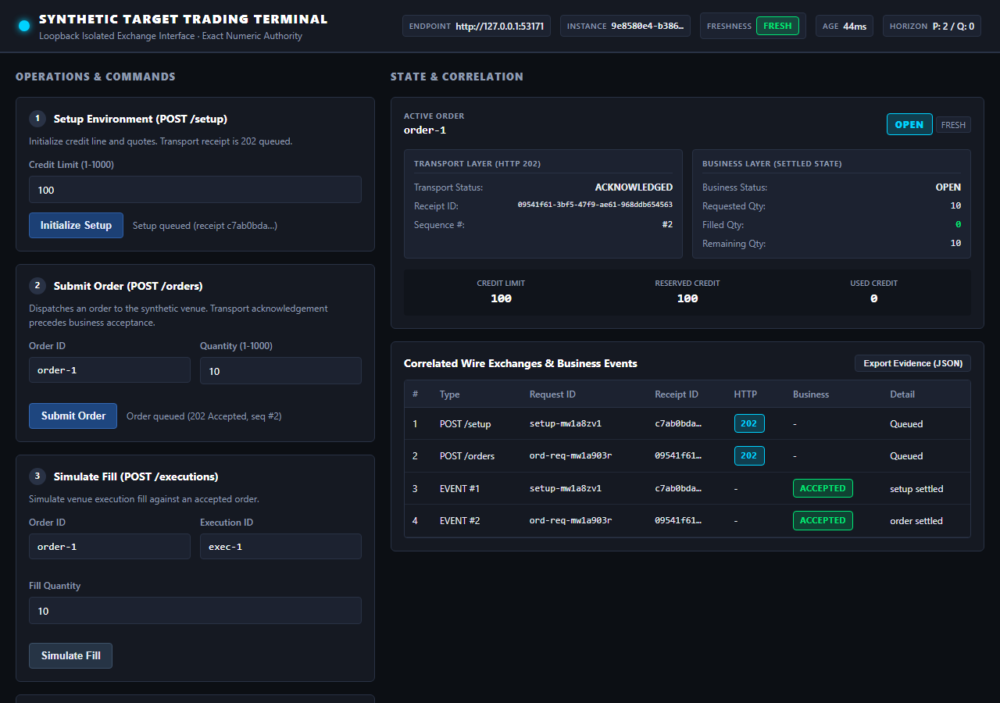

# Interactive Target Trading UI & Browser Journey

## Overview

ChaosPilot includes an interactive target trading interface and an automated end-to-end browser journey for synthetic trading. The target UI is served directly on the isolated loopback target listener's own origin (`http://127.0.0.1:<port>/`), preserving the strict numeric loopback Host, Origin, and Sec-Fetch-Site security boundary. The one exception is a same-site top-level document navigation (`Sec-Fetch-Mode: navigate`, `Sec-Fetch-Dest: document`, no `Origin`) to `/`, `/index.html` or `/target-ui.html`, which is how the workspace link opens the terminal; API paths, assets, cross-site navigations and all fetch/XHR traffic keep the original denial rules.

Sessions and journeys are launched only for a saved `synthetic-trading` profile at an explicit expected revision. The server validates `{ systemId, expectedRevision, variant }` (unknown fields rejected) and pins the system snapshot, target source hash, contract hash and UI/evaluator hashes into session and journey evidence before any listener or browser starts. The standalone CLI journey uses the seeded `trading-gateway` snapshot and records it the same way.

The feature makes **zero AI model calls** and does not alter the existing deterministic simulator or adapter business identities.

```
+-----------------------------------------------------------------------------------+
| ChaosPilot Workspace / Functional Tests View                                      |
| - Discovers synthetic-trading profiles & variants                                 |
| - Manages bounded target UI sessions via POST/DELETE /api/target-ui/session       |
| - Triggers automated browser journey via POST /api/target-ui/journey              |
+-----------------------------------------------------------------------------------+
       |
       | Launches ephemeral session on 127.0.0.1:<ephemeral-port>
       v
+-----------------------------------------------------------------------------------+
| Isolated Target HTTP Listener & Web Server (src/target-api/target.ts)             |
| - Origin: http://127.0.0.1:<ephemeral-port> (strict Host / Origin / Sec-Fetch)    |
| - Serves UI assets: /index.html, /target-ui.css, /target-ui.js                    |
| - Real endpoints: POST /setup, POST /orders, POST /executions                     |
|                   GET /state, GET /events, GET /orders/:id                        |
+-----------------------------------------------------------------------------------+
       |
       | Same-origin browser requests & WebSocket CDP automation
       v
+-----------------------------------------------------------------------------------+
| Synthetic Target Trading Terminal (public/target-ui.html & src/web/target-ui.ts)  |
| - Terminal visual identity distinct from ChaosPilot investigator workspace        |
| - Distinguishes HTTP 202 transport acknowledgement from business acceptance      |
| - FreshnessEngine: explicit monotonic age and sequence rule                       |
| - Intentional Hold Updates: retains older state, labels display STALE             |
| - Resume: converges to latest FILLED state within bounded real-time deadline      |
| - Inspectable & exportable self-contained correlated evidence JSON                |
+-----------------------------------------------------------------------------------+
```

---

## Architecture and Key Principles

### 1. Truthful Transport Acknowledgement
When an order or fill is submitted:
- The target returns `HTTP 202 Accepted` with a receipt `{ instanceId, receiptId, sequence, status: 'queued' }`.
- The UI immediately surfaces the transport acknowledgement as `QUEUED` / `HTTP 202`, while the business status remains `IDLE` or `OPEN`.
- **A transport receipt never establishes business success.** Only when the asynchronous event stream reports settlement does the business status update to `FILLED`.

### 2. Explicit Freshness Policy and Stale Update Detection
UI data freshness is governed by a pure `FreshnessEngine` (`src/target-ui/freshness.ts`):
- **Monotonic Clock**: Uses `performance.now()` for real elapsed time; never confuses simulator steps with milliseconds.
- **Freshness Rule**:
  - `status: 'fresh' | 'stale'`
  - Stale reason: `'held'` (intentional pause) or `'age-exceeded'` (elapsed time > `freshnessThresholdMs`, default 2000ms).
- **Hold Updates Simulation**:
  - Clicking **Hold Updates** stops applying incoming state mutations to the active order display.
  - The interface displays the amber `STALE (HELD)` badge and a visible warning alert.
  - The underlying target listener continues running in the background, processing fills and mutating its internal ledger.
  - While held, the display retains the older status (`OPEN`, filled: 0).
  - Clicking **Resume Updates** immediately polls the target, updates the display to `FILLED` (filled: 10, remaining: 0), and restores freshness to `FRESH`.
- **Integrity**: Out-of-order sequence observations (`processed < lastAppliedSequence`) and foreign instance IDs are rejected without regressing the display or falsely clearing stale flags.

### 3. Automated Browser Journey & Convergence Deadline
The browser journey runner (`src/target-ui/runner.ts` / `scripts/target-ui-browser.mjs`):
- Launches real headless Chrome or Microsoft Edge via `puppeteer-core`.
- Drives the actual DOM controls:
  1. Phase 1: Setup credit limit 100 via `#btn-submit-setup`.
  2. Phase 2: Submit order `order-1` for quantity 10 via `#btn-submit-order`, verifying immediate HTTP 202 receipt and eventual convergence to `OPEN`.
  3. Phase 3: Click `#btn-toggle-hold` to hold updates, verify `STALE` badge, submit fill for 10 units directly to `POST /executions`, and verify display retains `OPEN` and `STALE`.
  4. Phase 4: Click `#btn-toggle-hold` to resume updates, and await convergence condition (`status === 'FILLED'`, `filledQty === 10`, `remQty === 0`, `isFresh === true`) within an explicit bounded deadline (5000ms).
- Records the Node-side fill exchange in the evidence and proves upstream `FILLED` from recorded `GET /state` observations while the held DOM still shows `OPEN`; DOM observations are read back from the rendered page, not copied from controller state.
- Captures checkpoint screenshots at each phase under a unique per-run directory.
- Every failure mode (missing browser, timeout, abort, transport loss, DOM mismatch) returns classified partial evidence with target/browser cleanup instead of discarding the run.
- **Prerequisite**: an installed Chrome or Edge (`CHROME_BIN`/`EDGE_BIN` override). The browser runs with its normal sandbox. The default `npm test` suite does not require a browser; the real-browser tests are opt-in via `CHAOSPILOT_BROWSER_TESTS=1`, and `npm run ui-journey` is the dedicated check — a missing browser there yields inconclusive evidence and a non-zero exit, never a pass.

### 4. Independent Evaluator & Honest Classification
The evaluator (`src/target-ui/evaluator.ts`) analyzes the full correlated evidence. It ignores any caller-supplied verdict and requires, for a pass: pinned provenance; exactly one setup/order/execution exchange with correlated queued receipts in increasing sequence; the complete accepted business-event record matching those exchanges; a recorded `GET` observation proving upstream `FILLED` (drained, exact quantities) overlapping the held window; and actual-DOM observations for `after-order-transport`, `while-held` and `after-resume` in order on a monotonic clock, with the recorded thresholds and resume time proving convergence inside the deadline. Anything missing, foreign, reordered or malformed is inconclusive, never a pass:
- **`verified` (`pass`)**: All invariants satisfied, wire-to-DOM correlation proved, freshness transitions verified.
- **`ui-failure` (`fail`)**: Settled DOM displays contradictory status or wrong quantities after upstream reached `FILLED`, or UI premature pass upon HTTP 202.
- **`upstream-failure` (`fail`)**: Upstream target rejected a command or event (e.g. insufficient credit).
- **`inconclusive-wire` / `inconclusive-timeout` (`inconclusive`)**: Missing wire exchanges, missing observations, or convergence deadline exceeded.

---

## Evidence Format

The correlated evidence JSON (`target-ui-journey-evidence.json`, written by `npm run ui-journey`) contains:
- `id`, `startedAt`, `finishedAt`, `variant`, `resumeAtMs`, optional `runError` (`cancelled` | `timeout` | `browser` | `transport`) for partial runs
- `instanceId`, `endpoint`, `orderId`, `requestId`, `receiptId`
- `provenance`: pinned system snapshot (brief id/revision/adapter, contract), `sourceHash`, `contractHash`, `uiHash`, `evaluatorHash`
- `thresholds`: `{ freshnessThresholdMs: 2000, convergenceDeadlineMs: 5000 }`
- `exchanges`: full HTTP requests, status codes, response receipts, monotonic browser-clock timestamps, per-exchange `source` (`browser` | `runner`) and failure diagnostics
- `events`: asynchronous business events emitted by the target engine
- `uiObservations`: DOM snapshots read from the rendered page at each phase (`after-order-transport`, `while-held`, `after-resume`), each carrying instance/request identity, applied sequence and the freshness threshold in force
- Interactive exports from the terminal page itself are always marked `inconclusive` ("Manual interactive capture; not independently verified")
- `status` (`pass` | `fail` | `inconclusive`)
- `classification` (`verified` | `ui-failure` | `upstream-failure` | `inconclusive-wire` | `inconclusive-timeout`)
- `reasons`: discriminating invariant verification breakdown
- `screenshots`: paths to captured PNG files

---

## How to Run

### Automated Browser Journey via CLI
```sh
# Execute against clean reference target (passes all checks)
npm run ui-journey

# Or execute script directly with options
node scripts/target-ui-browser.mjs --variant clean
```

### From ChaosPilot Workspace
1. Start the server: `npm run dev`
2. Open `http://127.0.0.1:4310/workspace`
3. Select any saved `synthetic-trading` system profile (e.g. `trading-gateway`)
4. Navigate to **Functional tests** in the sidebar
5. Scroll to the **Target UI journey & trading session** card:
   - Click **Launch Target UI session** to start an isolated ephemeral target listener and open the link to `http://127.0.0.1:<port>/`.
   - Click **Run Target UI journey** to run the headless browser journey and view/download the correlated evidence JSON.

### Running Unit & Integration Tests
```sh
# Run target UI focused test suite
npx vitest run tests/target-ui

# Run full repository checks
npm run typecheck
npm test -- --maxWorkers=4
```

## Verified workflow — 3 November 2026

The final host checks passed TypeScript checking, **1,553 default-suite tests**
(six real-browser tests are opt-in), **41 focused review-repair tests**, and all
**six real-browser checks**. The browser checks include normal convergence,
workspace-origin navigation with cross-origin API denial, and evidence retention
when cancelled after setup, order acceptance, and the held fill.

A separate browser click-through exercised the actual workspace launch and run
buttons, the terminal's order/fill/hold/resume controls, and the evidence download.
The downloaded JSON re-evaluated as verified with the selected brief revision and
source identities. Layout checks at 390px and 320px found no page overflow after
the form-grid repair; keyboard Tab reached the labelled setup field.



This screenshot is from a real local HTTP/browser journey against the clean
synthetic target. These checks made no model calls.
