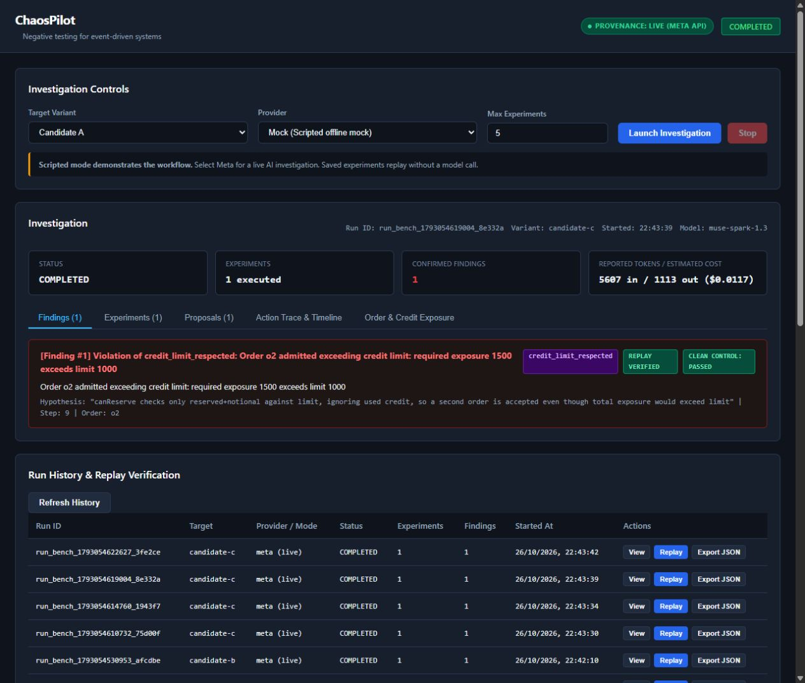
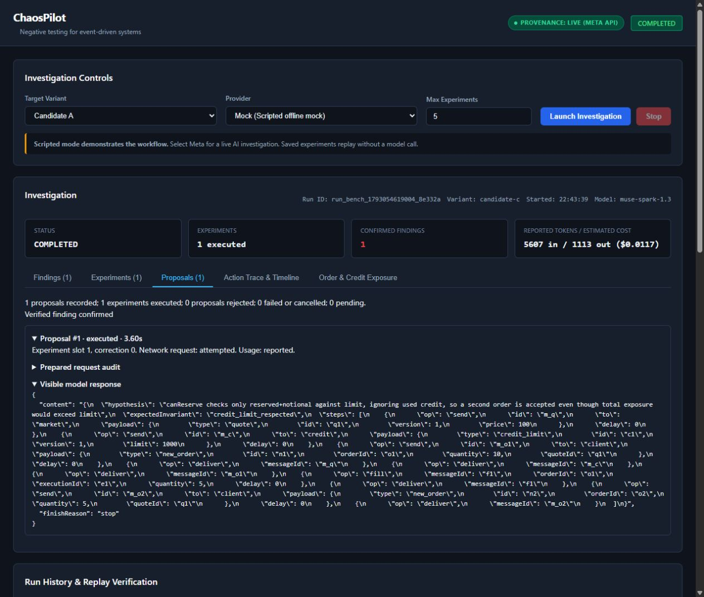

# Current workflow audit

Captured from the running local application for this design task. Scope: an engineer understands the configured business requirements, prepares a new investigation and inspects saved evidence. Desktop screenshots and visible DOM were inspected; keyboard, zoom and assistive-technology behaviour need separate verification.

## 1. Investigation runner — evidence works, system context is missing

The finding has visible live-model provenance, actual model identity, invariant evidence and clean/replay confirmation. These should be retained.

The visible screen has launch controls, investigation details and history, with no System or Requirements entry point. It does not show the system's business purpose, explicit rules, message vocabulary or verification readiness. Saved C/live evidence appears below A/mock controls for the next launch; these two contexts need distinct labels. Dense, small finding text and reliance on colour/status badges create readability risks; screenshots alone do not establish contrast or keyboard compliance.

Priority: make a system workspace and its business rules the entry point, with an explicit pinned revision for every investigation. Show next-launch configuration separately from saved evidence.

## 2. Proposal inspection — audit available, context is buried

Prepared requests, visible responses, outcome and timing can be inspected, preserving useful evidence. However, raw encoded JSON dominates the view. Business requirements cannot be authored or reviewed as first-class information, and engineers need to drill into request diagnostics to reconstruct what the investigator knew.

Priority: surface requirement descriptions and verification status, then concise hypothesis/action/observation detail. Keep raw request/response evidence available through disclosure controls. Distinguish confirmed executable rules from extra prose with no configured checker. Saving prose must not imply that a requirement has been tested or passed.

## Design handoff

`ASTRA_BRIEF.md` gives Astra the full product, business and implementation context. Astra owns a proposed journey and clickable design prototype under `astra/`. A separate functional implementation will add the basic system-brief workflow in the existing app. No conclusions about production transport support or full accessibility compliance follow from this audit.
