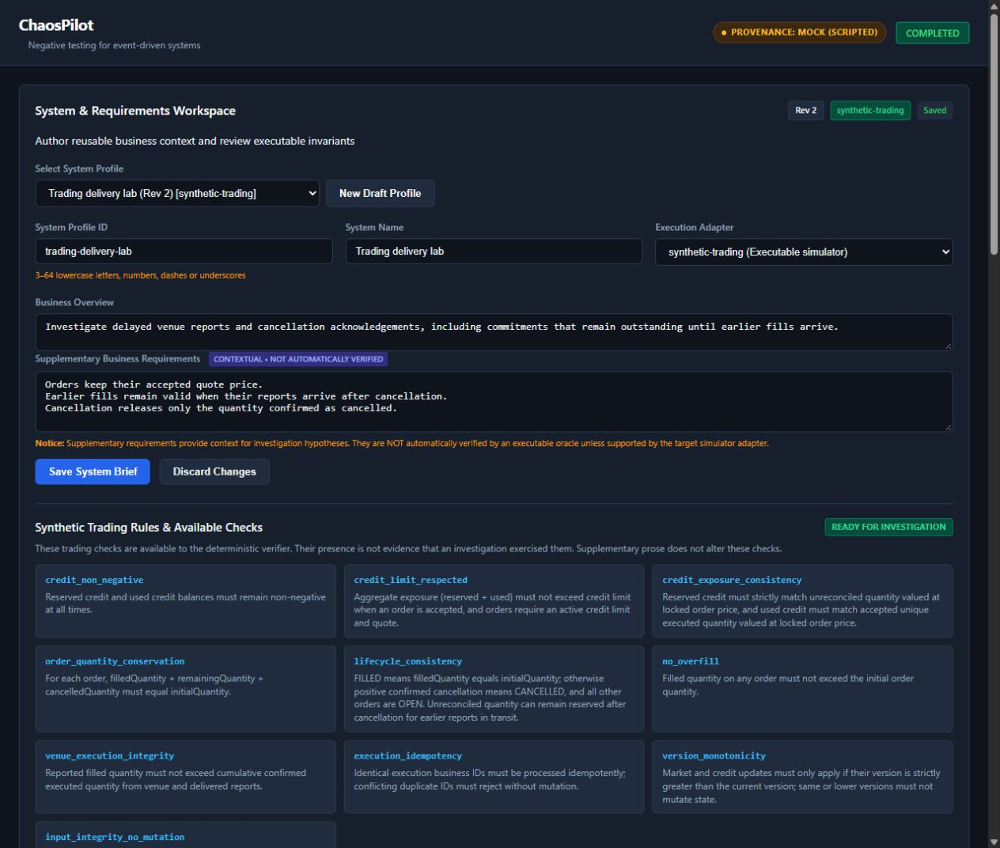
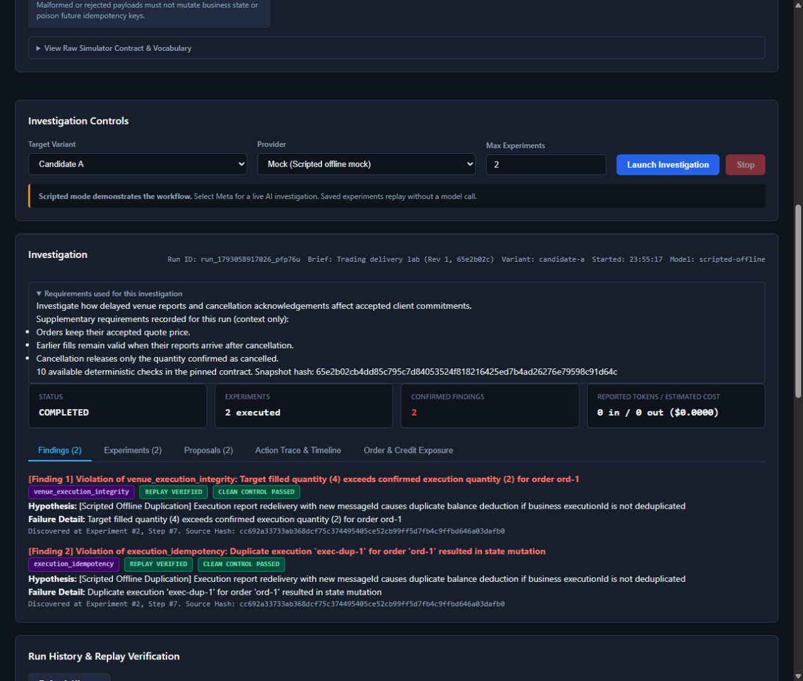
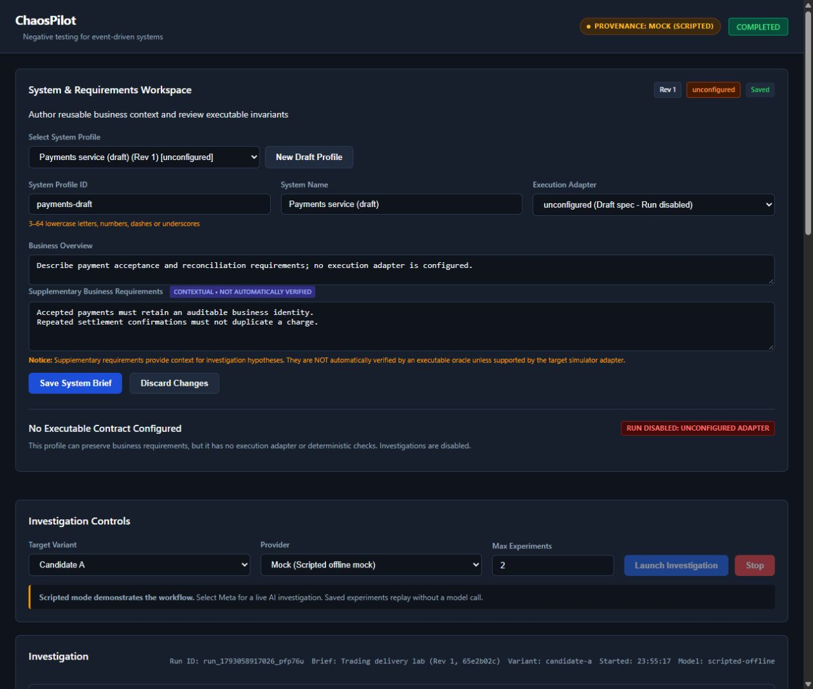

# Working application: requirements workflow check

Checked the updated application on `http://127.0.0.1:4310` in the in-app browser. Screenshots were captured during these checks, saved, then reopened and inspected. All new investigations used the scripted mock, with zero model calls.

1. **Define and save requirements — working.** A seeded trading brief exposes its business notes and ten read-only deterministic checks. Editing blocks launch; trying to create another profile while dirty preserves the typed work and asks for save/discard. A new draft stays blocked after selecting the trading adapter until it is saved. Created `trading-delivery-lab`, saved revision 1, then edited and saved revision 2. Screenshot 01 shows the actual editor and available rules. The final tenth card continues below the viewport; all ten were verified in the visible DOM.

   

2. **Inspect the requirements used by a run — working.** A browser-launched mock investigation pinned revision 1. Its expanded requirements panel retains the original overview and notes after the current profile becomes revision 2. The header identifies the saved revision and hash. Two invariant findings describe the same known duplicate-execution defect; they are not two independent defect discoveries. A separate CLI replay reproduced both experiments exactly, including trace, state, validity, rejections and violations. Screenshot 02 shows the pinned requirements and scripted evidence.

   

3. **Describe another system without claiming adapter support — working.** Created and saved `payments-draft` with an unconfigured adapter. Its business requirements persist, there is no executable-check display, and launch remains disabled. The CLI also rejects that saved profile before investigation. Screenshot 03 shows that blocked state. Returned the app to the trading profile afterwards.

   

The app remains a functional first version. Its dense form and combined preparation/history screen need the information hierarchy proposed by Astra. Check availability is not test coverage, supplementary prose is not an automatic oracle, and neither saving a profile nor choosing the trading adapter provides an external system integration. Keyboard-only journeys, responsive layouts, contrast and screen-reader behavior were not comprehensively verified; these screenshots do not establish accessibility compliance. API conflict/corruption/start-stop cases are covered by automated tests, not claimed as manual browser checks here.
